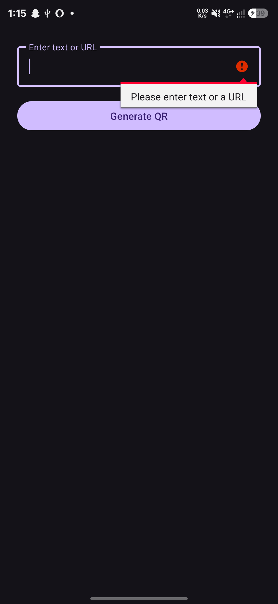
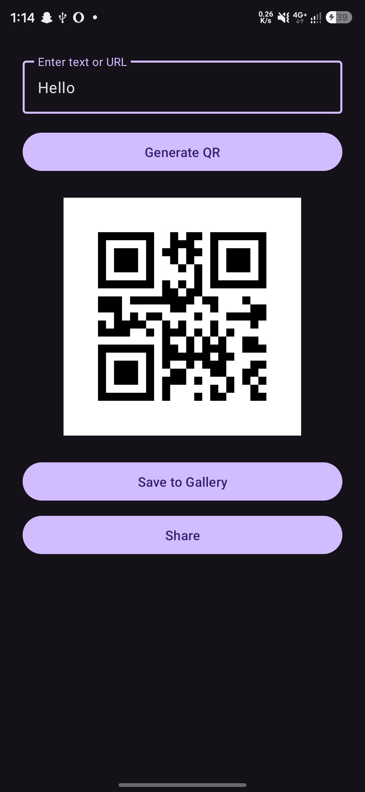
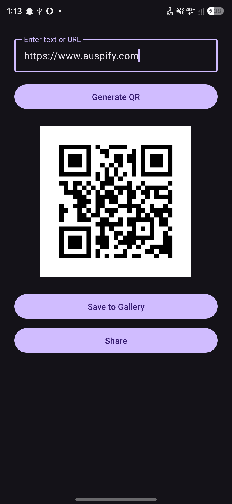
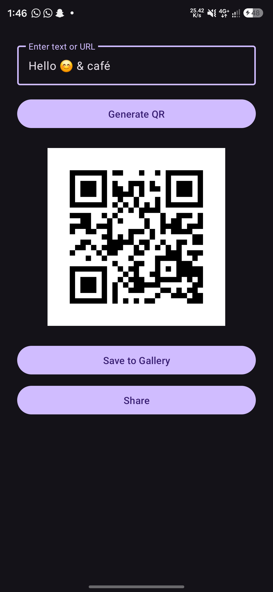
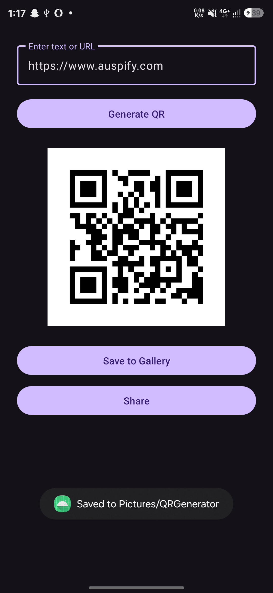
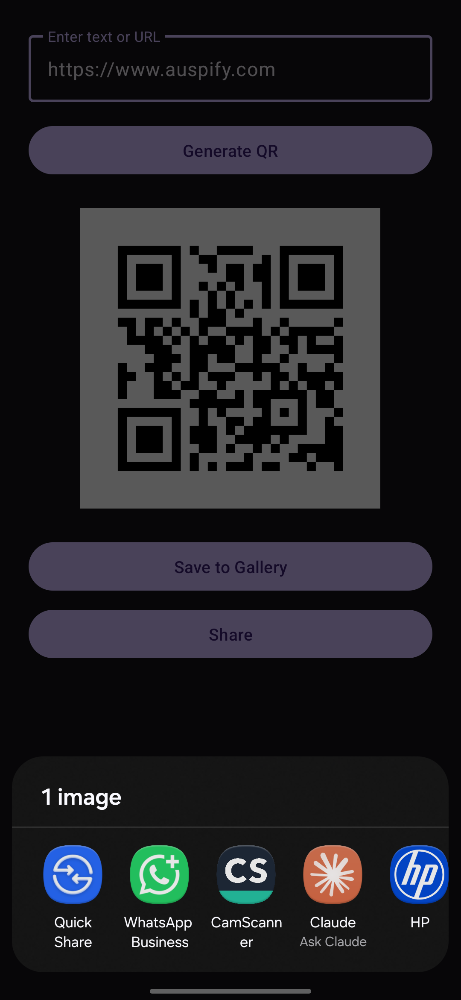
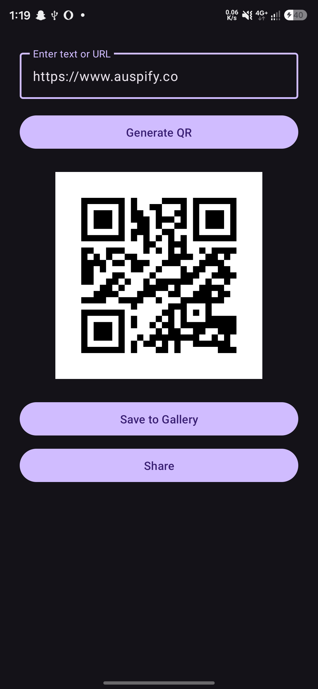
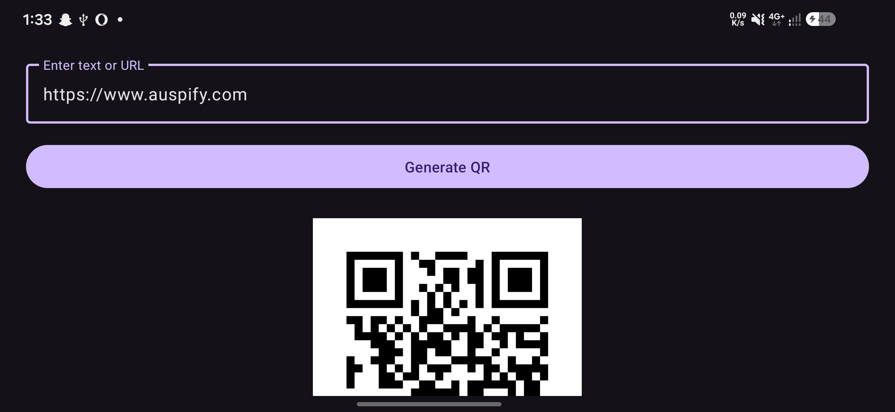

# QR Code Generator

An Android app that generates QR codes from text or URLs, and lets you save them to the gallery or share them with other apps.

Built as **Task 1** of the Auspify Technologies Android Developer Internship.

## Features

- Enter text or a URL and generate a QR code
- Input validation (shows an error on empty input)
- Save the QR code as a PNG image in `Pictures/QRGenerator`
- Share the QR code through any installed app
- QR code stays visible after screen rotation
- Scrollable layout that works in portrait and landscape

## Tech Stack

- Kotlin
- Android Studio, XML layouts, View Binding
- ZXing (`zxing-android-embedded`) for QR generation
- MediaStore for saving images, FileProvider for sharing

## Screenshots

| Empty input | Text QR | URL QR |
|---|---|---|
|  |  |  |

| Emoji and symbols | Saved to gallery | Share sheet |
|---|---|---|
|  |  |  |

| Updated QR | Landscape |
|---|---|
|  |  |

## Demo Video

[Watch the demo](Demo/qr_demo.mp4)

## How to Run

1. Clone the repository
2. Open it in Android Studio
3. Let Gradle sync
4. Run on an emulator or a device with Android 10 (API 29) or higher

## Author

Ameer, Auspify Android Developer Intern